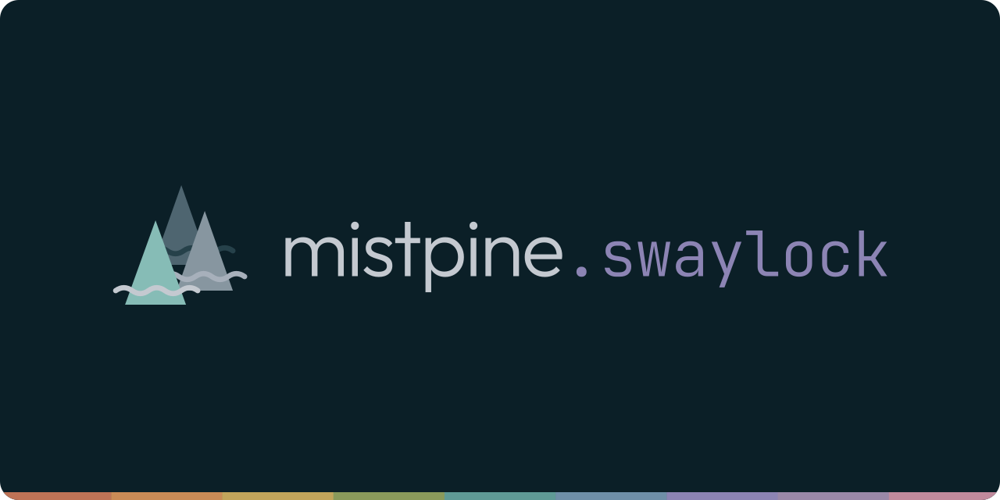
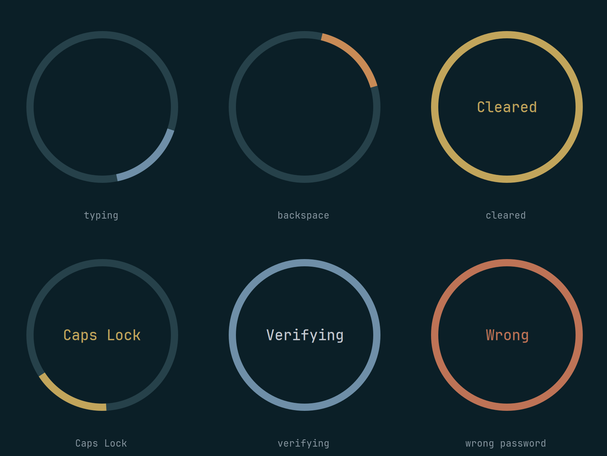

<p align="center">
  
</p>

<p align="center">
  
</p>

**mistpine** for [swaylock](https://github.com/swaywm/swaylock): cool, misty
grays over a deep blue-green night, with muted, earthy accents. It is the
swaylock port of [mistpine](https://github.com/mistpine/mistpine) and follows
the [mistpine spec](https://github.com/mistpine/mistpine/blob/main/docs/spec.md):
every color is the spec's, generated from its palette file and checked
against swaylock itself.

- Every one of swaylock's 29 color options, for every state of the lock
  screen.
- A quiet `bg4` ring on the spec's canvas; keys light it in the accent,
  backspace in orange. Verifying in blue, a wrong password in red, cleared
  input and Caps Lock in yellow.
- Colors only: fonts, the indicator's size and images stay yours.
- swaylock 1.7.2 and later, including 1.8.

The screenshot is the real app, swaylock 1.8.4 on sway, typed into with
wtype, and the render fails if a single state comes out in other colors.

## Install

swaylock has no `include`, so the colors go into your config itself. With
no swaylock config yet:

```sh
mkdir -p ~/.config/swaylock
curl -fsSL -o ~/.config/swaylock/config \
  https://raw.githubusercontent.com/mistpine/mistpine.swaylock/main/themes/mistpine.conf
```

With one, add the lines to it and remove your own color lines:

```sh
curl -fsSL https://raw.githubusercontent.com/mistpine/mistpine.swaylock/main/themes/mistpine.conf \
  >> ~/.config/swaylock/config
```

swaylock reads the file each time it starts, so the next lock uses it.

The screenshot also sets these, which are yours to choose:

```ini
font=JetBrains Mono
font-size=40
indicator-radius=100
indicator-thickness=10
indicator-caps-lock
```

`indicator-caps-lock` lights the ring in yellow while Caps Lock is on;
without it, only the text says so.

## Colors

| State | Ring | Text | Keys |
| --- | --- | --- | --- |
| Typing | `bg4` `#26414a` | `fg3` `#c4c9d0` | `blue` `#6f8fa8`, backspace `orange` `#c98b56` |
| Verifying | `blue` | `fg3` | |
| Wrong | `red` `#be7356` | `red` | |
| Cleared | `yellow` `#c2a55b` | `yellow` | |
| Caps Lock | `bg4` | `yellow` | `yellow`, backspace `orange` |

The screen and the inside of the ring are the spec's canvas, `bg1`
`#0b1f27`. The lines around the ring are transparent. The keyboard layout
(`show-keyboard-layout`) sits on a status-line chip, `bg2` `#0f272e` under
`fg2` `#a7b0bb`.

## Development

Requires Node 24+, pnpm (`corepack enable`) and Docker.

The spec loader, color math, banner and pixel checks come from
[@mistpine/port-kit](https://github.com/mistpine/port-kit), shared by every
mistpine port.

```sh
pnpm install
pnpm generate  # themes/mistpine.conf from the mistpine spec
pnpm check     # fail if it is out of date
pnpm verify    # swaylock 1.7.2 and 1.8.4 show every state in the spec's colors
pnpm render    # the README screenshot from swaylock, with pixel checks
pnpm banner    # assets/banner.svg and the social preview (Chromium)
pnpm lint && pnpm typecheck
```

Never edit `themes/` by hand. `scripts/generate.ts` maps each color option to
a spec role, reads the colors from
[`palette/mistpine.json`](https://github.com/mistpine/mistpine/blob/main/palette/mistpine.json)
(from `$MISTPINE_DIR`, `../mistpine` or GitHub), requires all 29 options, and
4.5:1 for every text color on the ring's inside.

`pnpm verify` and `pnpm render` lock headless sway in Docker: Ubuntu 24.04
for swaylock 1.7.2, Ubuntu 26.04 for swaylock 1.8.4
(`scripts/render/Dockerfile`). swaylock reports an unknown option and still
locks, and takes a broken color without a word, so verify reads every option
back from the file, fails on anything swaylock prints, then types with wtype
through each state (`scripts/render/states.sh`) and checks its colors on
screen, pixel by pixel. A wrong password takes PAM about three seconds to
refuse, so that state is captured every half second and the reddest frame
counts.

## Credits

- Designed in [themes.utimura.io](https://themes.utimura.io).
- [Outfit](https://github.com/Outfitio/Outfit-Fonts) and
  [JetBrains Mono](https://github.com/JetBrains/JetBrainsMono) in the banner.
  The screenshot uses JetBrains Mono.

## License

[MIT](LICENSE).
